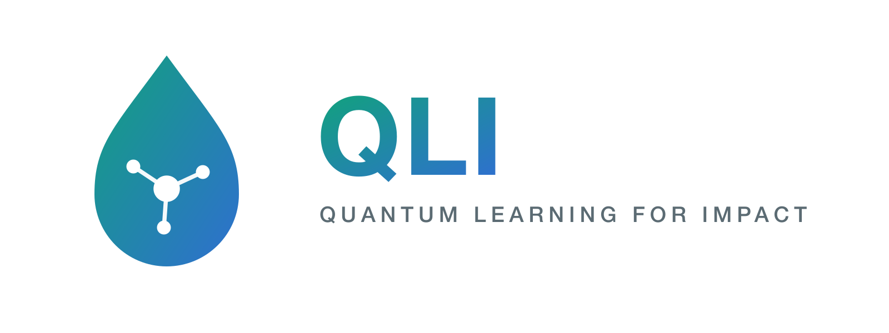

<p align="center"></p>

# Onde furar os poços? Alocação de poços no semiárido pernambucano com QAOA

Projeto do grupo **Quantum Learning Impact (QLI)** no programa Quantum Immersive.

Em 30 de junho de 2026, Pernambuco decretou situação de emergência por estiagem em 75 municípios do Sertão e do Agreste. A resposta do estado passa pela perfuração de poços e pela construção de adutoras, e decidir onde perfurar é uma escolha pública recorrente e cara. O projeto se alinha ao ODS 11, Meta 11.5: reduzir o número de pessoas afetadas por desastres, incluindo os relacionados à água.

## O problema

Um poço na cidade *i* abastece a própria cidade e as vizinhas, isto é, as cidades a menos de 60 km, o alcance aproximado de uma adutora. O objetivo é escolher o menor número de poços que deixe toda cidade abastecida, por poço próprio ou de uma vizinha.

Isso é o **Problema do Conjunto Dominante Mínimo** (MDS), que é NP-difícil. O grafo de vizinhança vem de uma triangulação de Delaunay sobre as coordenadas dos municípios, filtrada pela distância de 60 km.

## A formulação

Uma variável binária por cidade (um qubit por cidade), com a restrição de cobertura convertida em penalidade, seguindo Lucas (2014):

$$H = B\sum_i x_i + A\sum_i \prod_{u \in N[i]} (1 - x_u)$$

O primeiro termo conta os poços. O segundo vale 1 só quando nenhum poço cobre a cidade *i*. Nos experimentos, B = 1 e A = 8. Trocando cada variável por um operador de spin, o custo vira um modelo de Ising, resolvido com QAOA em Qiskit, com ângulos otimizados por COBYLA. Cada resultado é conferido contra a solução exata por força bruta.

## Resultados

| Recorte | Cidades | Poços no ótimo | Simulação | QPU real |
|---|---|---|---|---|
| Sertão do Pajeú | 5 | 1 (Carnaíba) | ✅ | ✅ |
| Chapada do Araripe | 6 | 2 (4 ótimos empatados) | ✅ | ✅ |
| Núcleo central do Pajeú | 10 | 2 | ✅ | |
| Sertão do Pajeú | 18 | 3 | ✅ | |

- **Pajeú, 5 cidades.** Carnaíba é vizinha das outras quatro, então um poço basta. Na medição do estado final do QAOA, a configuração "poço só em Carnaíba" é a mais provável.
- **Araripe, 6 cidades.** São necessários dois poços, com quatro escolhas igualmente boas (por exemplo, Ipubi e Santa Cruz). Na profundidade usada, o QAOA não coloca os ótimos no topo, mas cobre todas as cidades em 98% das medições e, ficando com a melhor amostra, recupera um ótimo.
- **10 e 18 cidades.** O QAOA passa a funcionar como heurística: cobre todas as cidades em cerca de 90% das medições e concentra a probabilidade em energias mais baixas que um sorteio aleatório.
- **Hardware real.** O circuito do Pajeú rodou em uma QPU da IBM (arquitetura Heron) com 8192 medições. O hardware favorece soluções com menos poços que o acaso e, entre as medições de um único poço, escolhe Carnaíba em mais da metade das vezes, contra 20% esperados ao acaso.
- **Limite de escala.** O gargalo para rodar os casos maiores em hardware é a profundidade do circuito (portas de dois qubits), não o número de qubits.

O relatório completo está em [`relatorio_quantum_immersive.docx`](relatorio_quantum_immersive.docx) e a apresentação em [`QLI_apresentacao.pdf`](QLI_apresentacao.pdf).

## Estrutura

```
├── alocacao_pocos_qaoa_pajeu5.ipynb    # Pajeú, 5 cidades (inclui execução na IBM)
├── alocacao_pocos_qaoa_araripe.ipynb   # Chapada do Araripe, 6 cidades
├── alocacao_pocos_qaoa_pajeu10.ipynb   # núcleo central do Pajeú, 10 cidades
├── alocacao_pocos_qaoa_pajeu18.ipynb   # Sertão do Pajeú, 18 cidades
├── data.ipynb, datasets_crus.ipynb     # coleta e preparo dos dados (IBGE, NASA POWER)
├── rodar_ibm_pajeu5.py                 # roda o Pajeú-5 na QPU da IBM
├── rodar_ibm_pajeu5_sucesso.py         # roda o Pajeú-5 na IBM e gera a figura de resultado
├── dados/                              # CSVs, geojson dos municípios, figuras e logos
├── relatorio_quantum_immersive.docx
└── QLI_apresentacao.pdf
```

## Como rodar

Requer Python 3.12.

```bash
uv sync
```

Para abrir os notebooks na IDE, escolha o kernel do `.venv` do projeto.

Os notebooks rodam no simulador sem configuração extra. Para executar na IBM, salve seu token uma vez (pegue em [quantum.ibm.com](https://quantum.ibm.com)):

```python
from qiskit_ibm_runtime import QiskitRuntimeService
QiskitRuntimeService.save_account(channel="ibm_quantum_platform", token="SEU_TOKEN", overwrite=True)
```

## Dados

- Municípios, coordenadas e contornos: IBGE.
- Produção agrícola por município: [API SIDRA do IBGE](https://apisidra.ibge.gov.br/).
- Clima histórico: [NASA POWER](https://power.larc.nasa.gov/).

## Equipe

Eduarda Mendes, Felipe Estevam, Isabel de Castro, Luca Borges e Miguel Estivalet.

## Referências

- Lucas, A. (2014). Ising formulations of many NP problems. *Frontiers in Physics*, 2, 5. [doi:10.3389/fphy.2014.00005](https://www.frontiersin.org/journals/physics/articles/10.3389/fphy.2014.00005/full)
- ONU Brasil, [ODS 11](https://brasil.un.org/pt-br/sdgs/11).
- [Defesa Civil de Pernambuco](https://www.defesacivil.pe.gov.br/).
